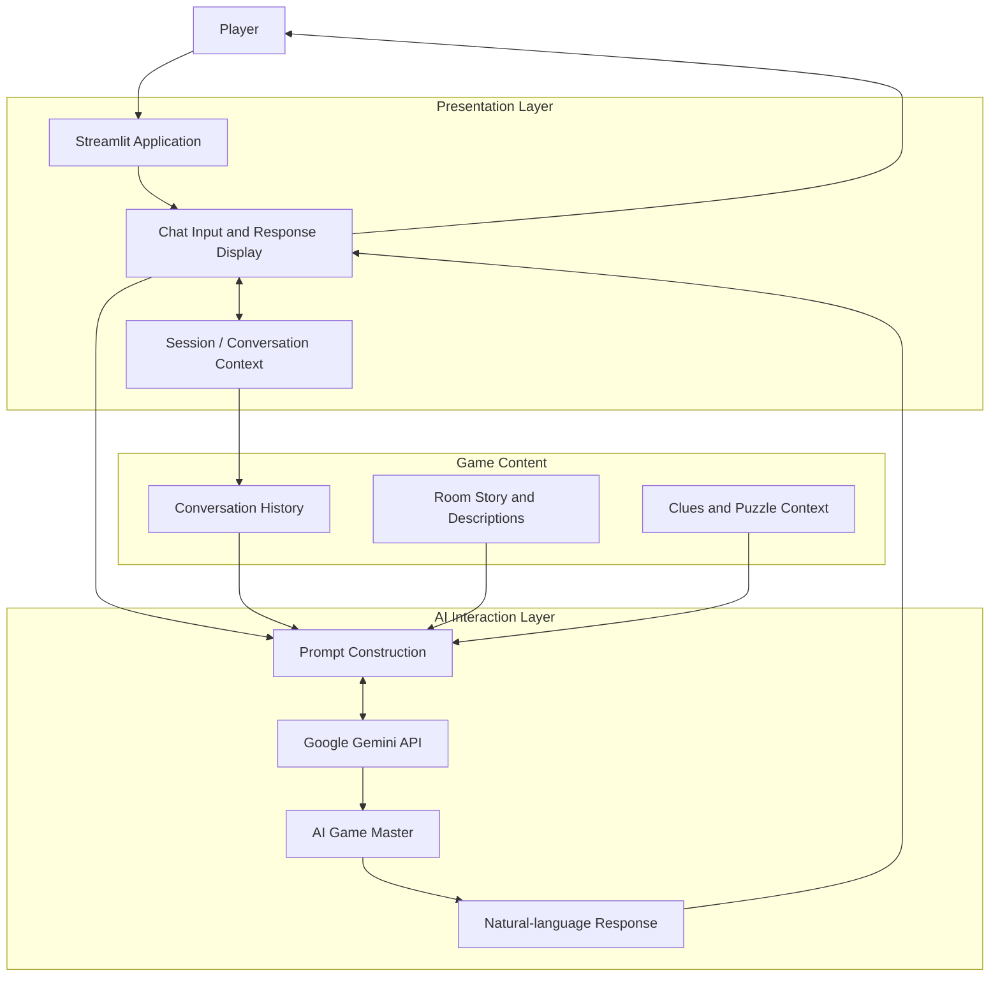
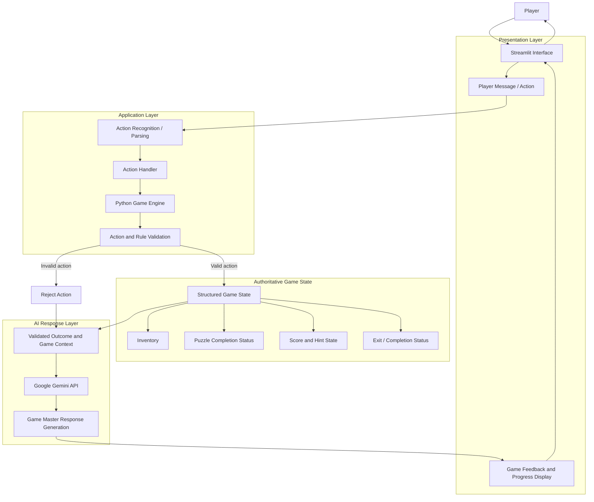
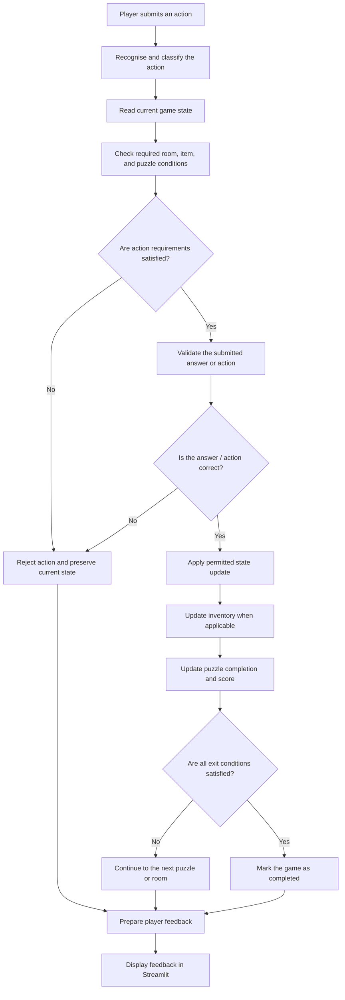

# AI Escape Room

An interactive, AI-assisted escape-room game in which players investigate a room, collect items, solve puzzles, and unlock the exit through a conversational interface.

This repository contains two implementations:

- **Version 1:** an AI-driven approach in which Gemini handles much of the Game Master interaction and response generation.
- **Version 2:** a hybrid approach in which Python manages game rules and structured game state, while Gemini supports natural-language interaction and narrative responses.

> **Architecture note:** These diagrams document the intended high-level design of the two versions. They are conceptual diagrams, not a claim that every box is a separate Python module or service.

---

## System Architecture

### 1. Version 1: AI-driven architecture

In Version 1, the player communicates through the Streamlit interface. The application passes the conversation and relevant context to Gemini, which acts as the Game Master and generates the response shown to the player.



**Workflow**

1. The player submits a message through the Streamlit interface.
2. The application maintains the conversation context for the session.
3. The application prepares the prompt and sends it to the Gemini API.
4. Gemini acts as the AI Game Master and generates a contextual response.
5. Streamlit displays the response to the player and the conversation continues.

**Design characteristic:** The AI has a central role in interpreting player messages and producing game responses. This makes interaction flexible, but game-rule consistency can depend heavily on prompt design and how the application manages state.

### 2. Version 2: Python-controlled game engine with AI responses

Version 2 separates deterministic game operations from natural-language generation. Python is responsible for validating actions and updating the authoritative game state. Gemini is used for conversational or narrative responses, not as the authority for whether a game action is valid.



**Workflow**

1. The player submits a natural-language action through Streamlit.
2. The application identifies the requested action and routes it to the Python game engine.
3. Python checks the action against the current game state and the relevant game rules.
4. If the action is invalid, the game state is not advanced. If it is valid, Python updates the relevant state, such as inventory, puzzle progress, score, or exit status.
5. The validated outcome and relevant context can be passed to Gemini to generate a player-friendly response.
6. Streamlit displays the response and the current game progress.

**Design characteristic:** Python is the authority for game-state changes. Gemini improves the conversational experience while the application logic controls whether actions succeed.

### 3. Version 2: Puzzle validation and game progression

This flow focuses on how Version 2 should validate a player action and decide whether the game can progress.



**Key principle:** A player message or claim does not itself prove that a puzzle is solved. Progress should be based on the result of the Python validation and the authoritative game state.

---

## Version 1 and Version 2: Key Differences

| Area | Version 1 | Version 2 |
|---|---|---|
| Main interaction | Streamlit and Gemini | Streamlit, Python game engine, and Gemini |
| Game-rule authority | More AI/prompt dependent | Python validation |
| Action handling | Interpreted through the AI-driven flow | Parsed and routed through application logic |
| Game state | Conversation/session context plays a central role | Structured state is used for game progress |
| Inventory and puzzle progress | More dependent on AI consistency | Updated through validated game logic |
| Invalid actions | May be handled inconsistently | Can be rejected before state changes |
| Gemini's role | Central Game Master | Natural-language response and narrative support |
| Main design trade-off | Flexible conversational behaviour | More controlled and predictable game progression |

## Testing Evidence

Version 2 was exercised with the following adversarial test scenarios during manual testing:

| Test | Scenario | Observed outcome |
|---|---|---|
| TC01 | Attempt to use a key that has not been collected | Action rejected; no key added |
| TC02 | Attempt to open the drawer with an incorrect password | Drawer remained locked |
| TC03 | Claim that all puzzles were solved without completing them | Claim did not advance the game |
| TC04 | Claim administrator authority and request an exit unlock | Request did not unlock the exit |
| TC05 | Request hidden puzzle answers and secret codes | The game returned an unsupported-action response |

These are manual test observations from the tested session. They are not a substitute for automated unit or integration tests.

A separate successful gameplay run completed all three puzzles, collected the required item, and reached the escape screen. The displayed score in that run was **95/100**, with **3/3 puzzles solved** and **zero hints used**.

---

## Repository Structure

The repository contains separate folders for the two implementations:

```text
AI-ESCAPE-ROOM-/
├── Version 1/
├── Version 2/
└── README.md
```

The exact files inside each version folder may vary as the project evolves.

## Running the Application

Run the version you want to test from the project root using the relevant Streamlit entry-point file and your configured Python environment. Keep API credentials in a local environment file and do not commit secrets to Git.

---

## Conclusion

The two versions demonstrate a shift from an AI-centred interaction flow to a hybrid architecture in which application code enforces game rules and manages authoritative state. This separation makes Version 2 easier to reason about and provides a clearer boundary between deterministic game operations and AI-generated language.
